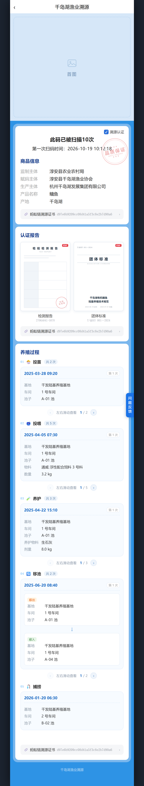

# 千岛湖陆基鱼 · 消费者扫码溯源页

陆基养殖（基地 / 车间 / 池子）场景的消费者扫码溯源 H5。单文件、零依赖、无需构建，双击即可打开。

对应网箱版现网页面：[consumer-scan.html](https://w13993552523.github.io/Qdl-H5-2/consumer-scan.html)



## 页面结构

| 模块 | 内容 |
| --- | --- |
| 顶部导航 | `‹` + 千岛湖渔业溯源 |
| 首图 | 后台配置位（当前为占位，接图片 URL 即可） |
| 商品信息 | 监制主体 / 赋码主体 / 生产主体 / 产品名称 / 产地，顶部含扫码次数、首次扫码时间、品质保证章 |
| 认证报告 | 检测报告、团体标准，两个 PDF 首页缩略图，点击查看 |
| 养殖过程 | 固定 5 个环节：投苗 → 投喂 → 养护 → 移池 → 捕捞 |
| 蚂蚁链溯源证书 | 每个模块底部各一条，含文号与查看入口 |

### 养殖过程字段

| 环节 | 字段 |
| --- | --- |
| 01 投苗 | 时间、基地 + 车间 + 池子 |
| 02 投喂 | 时间、基地 + 车间 + 池子、物料 + 数量 |
| 03 养护 | 时间、基地 + 车间 + 池子、养护物料 + 剂量 |
| 04 移池 | 时间、移出（基地/车间/池）、移入（基地/车间/池） |
| 05 捕捞 | 时间、基地 + 车间 + 池子 |

每个环节内可左右滑动查看多次记录，一次只展示一条；卡片下方有滑动提示条，两端箭头可点，序号随滑动更新。只有一条记录的环节自动隐藏提示条。

## 本地预览

直接双击 `index.html`，或用任意静态服务器：

```bash
python -m http.server 8080
# 打开 http://localhost:8080
```

## 部署到 GitHub Pages

```bash
git init
git add .
git commit -m "feat: 陆基溯源扫码页"
git branch -M main
git remote add origin https://github.com/<你的用户名>/<仓库名>.git
git push -u origin main
```

然后在仓库 **Settings → Pages → Build and deployment** 里，Source 选 `Deploy from a branch`，Branch 选 `main` / `/ (root)`，保存后访问：

```
https://<你的用户名>.github.io/<仓库名>/
```

仓库根目录已放 `.nojekyll`，避免 GitHub Pages 跑 Jekyll 处理本仓库文件。

## 说明

- 页面内所有养殖数据（基地、车间、池号、投喂物料、时间等）均为**演示数据**，与后台无关。
- 首图目前是配置占位（虚线框 + 「首图」），替换方式：把 `.banner` 里 `.bn-ph` 整块换成 ``，并在 `.banner img` 上加 `width:100%;display:block`。
- 颜色取自现网：页面底 `#2e93e5`、内容托盘 `#7ab7ed`、标题蓝 `#1b408f`、正文 `#222`、标签灰 `#a6a6a6`。
